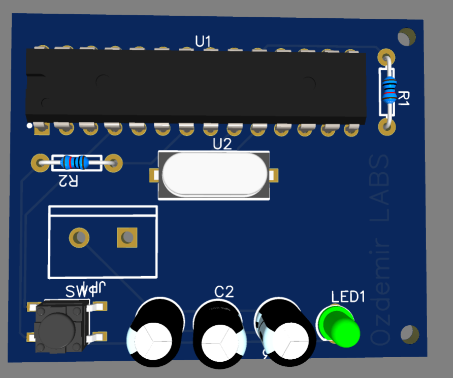
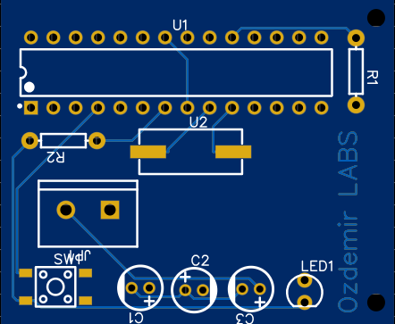
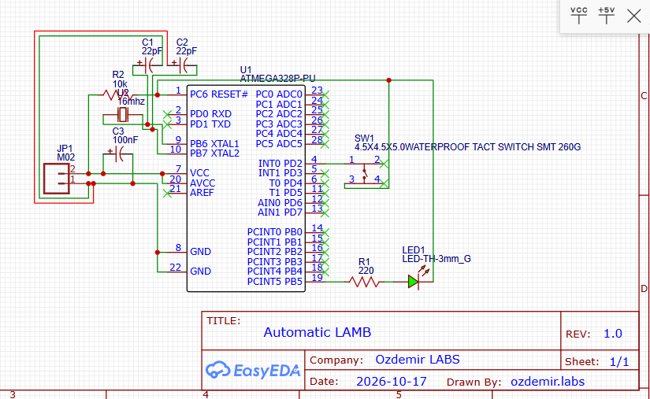

# Automatic-LAMB

Welcome to the official repository of **KartPass**, a smart desk lamp and timer control board meticulously designed and developed by **Ozdemir Labs**. This hardware project features a highly stable, custom PCB layout built around the ATmega328P-PU microcontroller, offering an automated, reliable, and energy-efficient lighting control solution.

---

## 📸 Project Visuals

Here are the complete design stages and technical schematics of the hardware:

### 1. 3D Render View

### 2. 2D Top/Bottom Layout

### 3. Schematic Diagram

---

## 🛠️ About the Designer & Creator

Hi there! I am **Abdullah Özdemir**, the technical mind behind **Ozdemir Labs** and the manager of **Özdemir Teknik Bilgisayar**. 

I am a certified computer technician with extensive training and practical experience in hardware troubleshooting, computer assembly, software configuration, operating system installations, and electronic diagnostic services. 

### My Journey & Expertise:
*   **Computer Repair & Assembly:** Advanced experience in building desktop setups, diagnostic methodologies, and component maintenance.
*   **Software & Flashing:** Deep knowledge in operating system deployment, bootloader management, and software configuration tools.
*   **PCB Design Journey:** Although I am **new to the field of PCB design**, I adapt incredibly fast to industrial design guidelines. I approach hardware routing with high discipline, mathematical precision, and an eye for physical reliability.

**Ozdemir Labs** aims to deliver commercial-grade hardware kits and servicing tools, bridging the gap between traditional reliability and modern microcontroller technology.

---

## ⏳ Project Background & Effort

This project is the result of true dedication and precision engineering. I spent **exactly 4 hours** working on this specific iteration, moving from circuit topology and schematic design to final component routing. 

The original goal was to build a clean, production-ready tool. After refining trace spacing and running strict design verifications, the design successfully passed the **DRC (Design Rule Check) with 0 errors**, ensuring the PCB is fully optimized for professional manufacturing and effortless manual soldering.

---

## ⚙️ Technical Specifications

This intelligent desk lamp controller utilizes a robust minimum system design to maximize durability and processing efficiency:

*   **Main Controller (MCU):** `ATmega328P-PU` (28-pin DIP package for extreme durability and easy manual soldering/replacement).
*   **Clock Frequency:** `16MHz Crystal Oscillator` supported by dual `22pF` ceramic loading capacitors for precise timing control.
*   **Input Voltage Interface:** `2-Pin Screw Terminal` (5mm Pitch) allowing secure and highly robust external power connections.
*   **User Input Interface:** `SW-TH_TACT-4P` Tantil Button configured with firmware-based control parameters.
*   **Visual Feedback:** High-brightness `3mm Through-Hole LED` serving as a system status and timer indicator.
*   **System Protection & Filtering:** 
    *   `10kΩ Pull-Up Resistor` on the RESET pin to completely eliminate accidental MCU resets caused by environmental noise.
    *   `220Ω Resistor` for optimal LED current limiting.
    *   `100nF (104) Non-Polarized Ceramic Capacitor` placed directly across power rails to absorb voltage ripples.

---

## 📦 Commercial Options & Demand

Modern automation demands robust, simple, and repairable hardware kits. By focusing on through-hole components (DIP/TH), this product solves the problem of surface-mount components that are difficult to repair at home.

We are currently evaluating this board for the following releases:
1.  **Bare PCB Option:** For electronics hobbyists who want to source and solder components themselves.
2.  **Disassembled Kit (DIY Kit):** Shipped with the custom PCB and all necessary high-grade through-hole components ready for assembly.

---

## 📜 License & Contributions
Developed by **Abdullah Özdemir / Ozdemir Labs**. All rights reserved. For commercial manufacturing licensing or custom hardware collaboration inquiries, feel free to open an issue or contact me via my GitHub profile.
